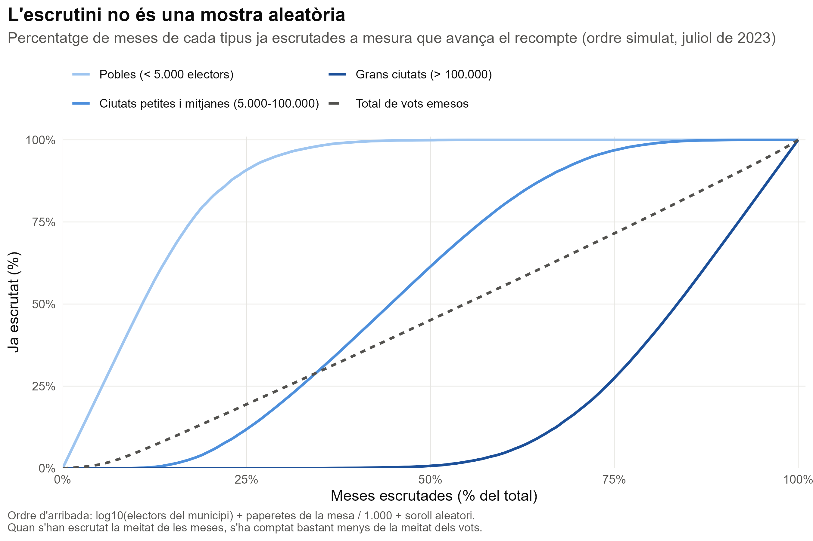
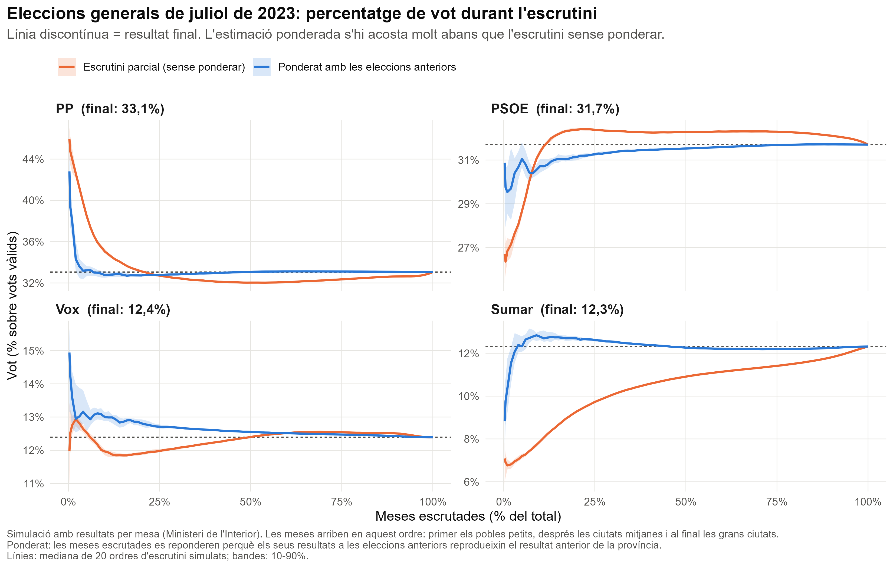
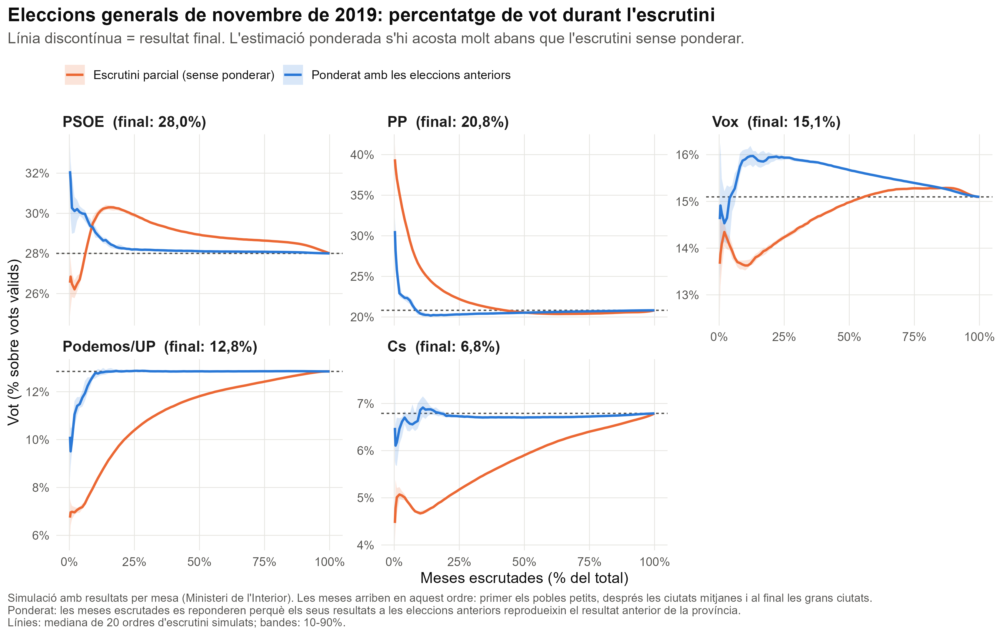
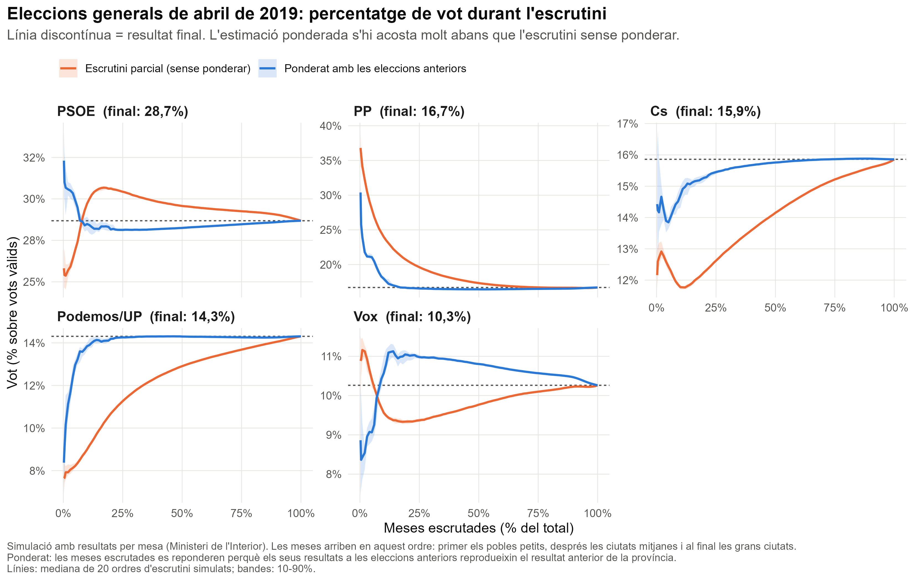
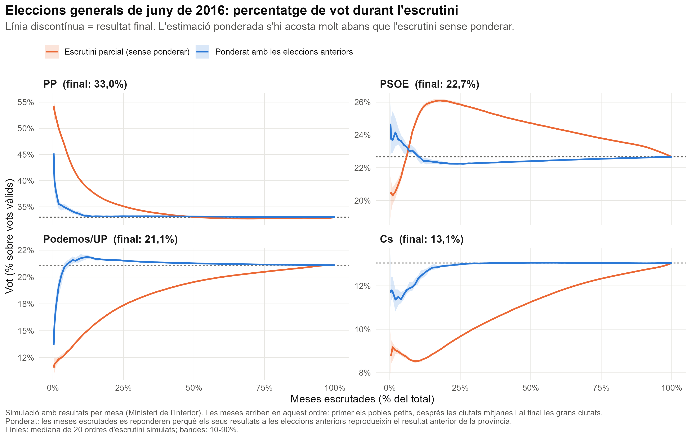
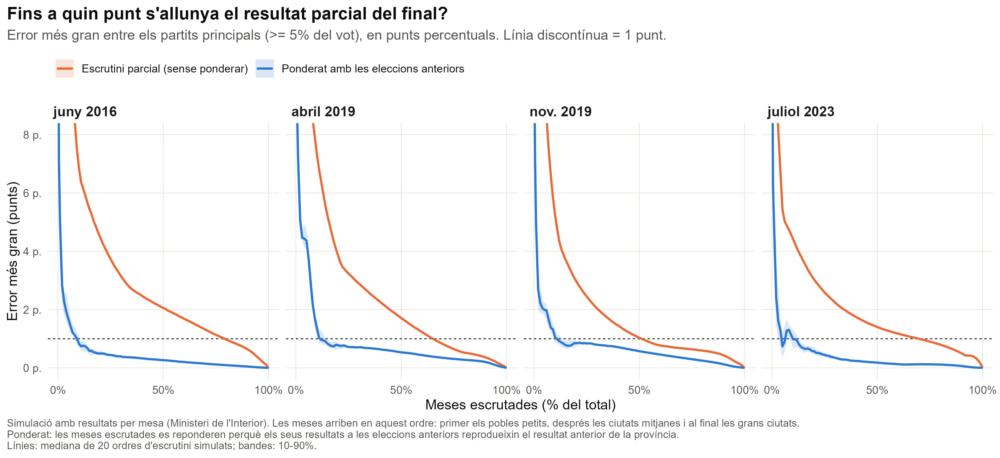
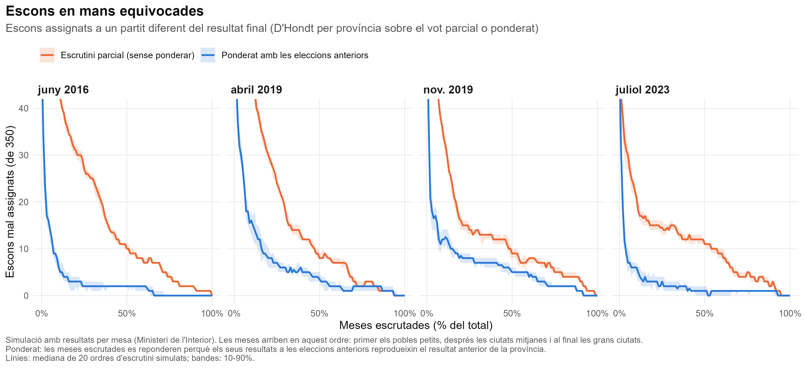
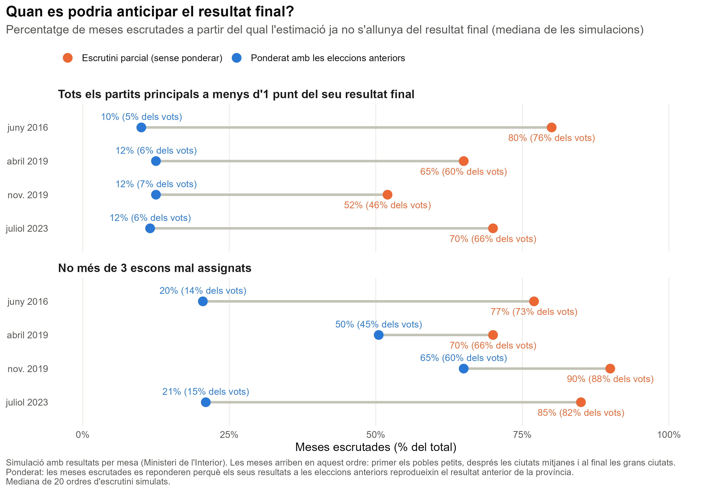

```{r}
#| label: setup
library(data.table)
library(knitr)

# Les figures en català es generen amb: Rscript R/02_figures.R ca
if (!file.exists("output/figures_ca/fig5_time_to_call.png")) {
  system2(file.path(R.home("bin"), "Rscript"), c("R/02_figures.R", "ca"))
}

S   <- readRDS("output/sim_results.rds")
res <- S$results; fin <- S$finals; cfg <- S$cfg
tt  <- fread("output/time_to_reliable.csv")

# format numèric català
n1 <- function(x, d = 1) formatC(x, format = "f", digits = d, decimal.mark = ",", big.mark = ".")
p0 <- function(x) paste0(n1(x, 0), "%")
p1 <- function(x) paste0(n1(x, 1), "%")

el_ca <- c("2016-06" = "juny de 2016", "2019-04" = "abril de 2019",
           "2019-11" = "novembre de 2019", "2023-07" = "juliol de 2023")

# composició de les meses del 2023 segons la mida del municipi
b23 <- S$booths[election == "2023-07"]
b23[, tram := cut(muni_census, c(0, 5000, 1e5, Inf), labels = c("pobles", "mitjanes", "grans"))]
comp <- b23[, .(meses = 100 * .N / nrow(b23), vots = 100 * sum(voters) / sum(b23$voters)), by = tram]
setkey(comp, tram)

# 2023: PP i PSOE en diferents moments de l'escrutini (mediana de simulacions)
m23 <- res[election == "2023-07" & party %in% c("PP", "PSOE"),
           .(sh = median(share), v = median(pct_votes)), by = .(method, party, pct_booths)]
g <- function(m, p, s) m23[method == m & party == p & pct_booths == s, sh]
gv <- function(s) m23[pct_booths == s, v][1]
f23 <- fin[election == "2023-07"]
fs <- function(p) f23[party == p, share]

# temps fins a resultat fiable
tget <- function(e, m, k, v = "pct_booths") tt[election == e & method == m & metric == k][[v]]
rng <- function(m, k) range(tt[method == m & metric == k, pct_booths])
fig <- function(f) file.path("output/figures_ca", f)
```

*[Versión en castellano](informe_escrutini_es.html)*

## Resum {.unnumbered}

La nit electoral, el Ministeri de l'Interior publica els resultats a mesura que s'escruten les meses. Aquest escrutini parcial **no és una mostra representativa**: primer arriben les meses dels pobles petits, on es vota molt diferent que a les grans ciutats, i les meses urbanes arriben al final. Per això, el resultat provisional pot ser enganyós durant bona part de la nit. De fet, és habitual que alguns partits comencin l'escrutini i estiguin bona part de la nit per davant i després es capgirin els resultats.

Per aquest motiu, sovint es recorre a les enquestes a peu d'urna (cares i sovint poc fiables) o a les enquestes fetes els dies previs a les eleccions, que són cares i poc precises. Alguns partits van desenvolupar la seva pròpia solució. Unió Democràtica de Catalunya (UDC), en l'època de Josep Antoni Duran i Lleida, el PSUC o el Partit Comunista Italià (PCI) eren coneguts per disposar d'un conjunt de "meses testimoni": meses seleccionades pel seu comportament electoral semblant al del conjunt, que feien servir per anticipar el resultat final abans que acabés l'escrutini. Aquest mètode, però, és costós, perquè exigeix una xarxa de persones en aquestes meses concretes, i depèn que aquestes meses s'escrutin ràpidament. El que es presenta aquí és una alternativa molt més senzilla i fiable, que aprofita totes les meses que ja s'han escrutat.

Aquest informe mostra que una correcció molt senzilla ho resol en gran part. N'hi ha prou de **ponderar les meses ja escrutades perquè, en conjunt, reprodueixin el resultat de les eleccions anteriors a cada província**. Amb les dades reals mesa per mesa de quatre eleccions generals (2016, abril de 2019, novembre de 2019 i 2023) i un ordre d'escrutini simulat, l'estimació ponderada situa tots els partits principals a menys d'un punt del seu resultat final amb només un `r p0(rng("Weighted", "share")[1])`-`r p0(rng("Weighted", "share")[2])` de les meses escrutades. L'escrutini sense ponderar necessita entre el `r p0(rng("Raw count", "share")[1])` i el `r p0(rng("Raw count", "share")[2])`. 

És un mètode semblant al que va fer servir la web https://apuracaoaberta.com.br/ que en les eleccions brasilenyes va predir el resultat final amb menys del 20% de les seccions escrutades.

## El problema: l'escrutini no és aleatori

Quan es tanquen els col·legis, cada mesa compta les seves paperetes i transmet el resultat. L'ordre en què arriben les dades no és atzarós, sinó que segueix un patró bastant previsible:

1. **Pobles petits i zones rurals.** Són les primeres meses a arribar. Tenen pocs electors censats, el recompte físic dura pocs minuts i els resultats es transmeten de seguida.
2. **Ciutats petites i mitjanes.** Arriben a mitja nit, de manera progressiva.
3. **Grans ciutats i barris densos.** Són les últimes. Hi ha centenars de votants per urna i més presència d'interventors, que poden alentir el procés amb reclamacions legítimes.

Com que el comportament electoral és molt diferent entre el món rural i el món urbà, l'escrutini parcial té un biaix sistemàtic. Durant la primera part de la nit sobrerepresenta els partits forts als pobles i infrarepresenta els partits forts a les ciutats. A més, el percentatge de meses escrutades (la xifra que es mostra a les pantalles) exagera l'avenç real del recompte. Al 2023, els municipis de menys de 5.000 electors tenien el `r p0(comp["pobles", meses])` de les meses però només el `r p0(comp["pobles", vots])` dels vots.

Això és problemàtic perquè implica que durant algunes hores a les pantalles de la TV s'està oferint (i comentant) informació esbiaixada que s'allunya del que serà el resultat final. Això pot generar confusió en l'audiència i, en un context com l'actual, pot afavorir teories de la conspiració sobre manipulació al recompte. A més, afavoreix que les TV públiques gastin diners en enquestes a peu d'urna o trackings dels darrers dies de campanya que son cars i poc fiables. Finalment, si el govern disposa de la informació corregida abans que la resta d'actors polítics, això pot donar-li un avantatge indegut en una nit electoral.

La @fig-ordre mostra l'ordre d'arribada simulat per a les eleccions de 2023. Quan ja s'han escrutat pràcticament totes les meses dels pobles, gairebé no s'ha comptat cap mesa de les grans ciutats. Amb el `r p0(50)` de les meses escrutades, s'ha comptat aproximadament el `r p0(gv(50))` dels vots.

{#fig-ordre}

## La solució: ponderar amb les eleccions anteriors

### La idea

Encara que no sabem com votaran les meses que falten, sí que sabem **com van votar a les eleccions anteriors**. Aquesta informació permet mesurar el biaix de les meses ja escrutades i corregir-lo.

Suposem que, en un moment de la nit, les meses escrutades d'una província havien donat a les eleccions anteriors un 45% al partit A, mentre que el conjunt de la província li havia donat un 35%. Llavors sabem que la mostra parcial està esbiaixada a favor d'aquest partit. La correcció consisteix a donar més pes a les meses que s'assemblen a les que encara falten (per exemple, les meses on A era més feble) i menys a les que estan sobrerepresentades, fins que el conjunt ponderat reprodueixi exactament el resultat anterior de la província. Els vots *actuals* d'aquestes meses, amb aquests pesos, donen l'estimació.

El supòsit és que, un cop igualat el perfil polític previ, les meses escrutades i les que falten canvien de manera semblant entre una elecció i l'altra. No cal que el canvi sigui igual a tot arreu, només que no estigui relacionat sistemàticament amb l'ordre d'arribada un cop tingut en compte el vot anterior.

### Com es fa, pas a pas

Per a cada moment de l'escrutini i cada província:

1. **Perfil previ de cada mesa.** Cada mesa actual s'associa a la seva secció censal de les eleccions anteriors. D'aquesta secció se'n pren el repartiment del cens entre partits, vot blanc i nul, i abstenció. Més del `r p0(floor(100 * min(S$match_info$section)))` de les meses s'associen directament per secció. La resta (seccions noves o redibuixades) pren el perfil del seu municipi.
2. **Objectiu.** Se suma aquest perfil per a totes les meses de la província, escrutades o no. Aquest és el resultat anterior que les meses escrutades han de reproduir.
3. **Calibratge.** Es busquen pesos per a les meses escrutades de manera que la suma ponderada del seu perfil previ coincideixi amb l'objectiu. S'usa el mètode de *raking* (calibratge exponencial), que dona sempre pesos positius. Les categories són els partits amb almenys un 3% del cens a la província a les eleccions anteriors, la resta de partits agrupats i l'abstenció.
4. **Estimació.** Els vots actuals de cada partit a les meses escrutades es multipliquen pels pesos i se sumen. Si una província té menys de `r cfg$min_booths` meses escrutades (o menys del `r p0(100 * cfg$min_frac)` de les seves meses, en les províncies petites), es fan servir les meses escrutades de tota la comunitat autònoma (o, si cal, de tot l'Estat), però calibrades igualment al perfil previ de la província.
5. **Escons.** Amb els vots estimats de cada província s'apliquen la fórmula D'Hondt i el llindar del 3%, igual que en el repartiment oficial.

El mètode no necessita fer correspondre els partits d'unes eleccions i les següents. Els pesos es calculen amb els partits de l'elecció anterior i s'apliquen als vots de qualsevol partit de l'actual, encara que sigui nou (com Vox el 2019 o Sumar el 2023).

## Dades i simulació

Les dades són els fitxers oficials de resultats per mesa del Ministeri de l'Interior per a les eleccions al Congrés de desembre de 2015, juny de 2016, abril de 2019, novembre de 2019 i juliol de 2023 (unes 57.000-60.000 meses per elecció). Les eleccions de 2015 només s'usen com a referència per ponderar les de 2016, perquè no es disposa de les de 2011. S'avaluen, doncs, quatre eleccions. El vot exterior (CERA) no s'inclou, perquè no es transmet per meses. El resultat final de referència és el recompte complet de totes les meses.

Els fitxers no diuen a quina hora va arribar cada mesa, de manera que l'ordre d'arribada s'ha **simulat** seguint la lògica descrita més amunt. Cada mesa rep una puntuació igual al logaritme del nombre d'electors del municipi, més un terme proporcional al nombre de paperetes de la mesa (les meses grans tarden més) i un soroll aleatori. Les meses s'escruten per ordre creixent de puntuació. Per tenir en compte la incertesa de l'ordre, la simulació es repeteix amb `r cfg$n_reps` ordres aleatoris diferents per elecció. Les figures mostren la mediana i l'interval del 10% al 90% d'aquestes simulacions.

## Resultats

### L'evolució de la nit electoral

Les figures següents mostren, per a cada elecció, com evolucionaria el percentatge de vot dels partits principals (els que superen el 5%) segons el nombre de meses escrutades. La línia taronja és el que es veuria a les pantalles. La línia blava és l'estimació ponderada. La línia discontínua és el resultat final.

::: {.panel-tabset}

## Juliol de 2023



## Novembre de 2019



## Abril de 2019



## Juny de 2016



:::

El patró es repeteix a totes les eleccions. Amb les primeres meses rurals, l'escrutini sense ponderar sobreestima molt el PP i infraestima els partits amb més vot urbà (Podemos/Unidas Podemos, Ciutadans, Sumar). El biaix es va reduint a poc a poc i només desapareix quan arriben les grans ciutats. L'estimació ponderada també és inestable durant els primers minuts, quan s'han escrutat molt poques meses, però s'estabilitza molt aviat a prop del resultat final.

El cas del juliol de 2023 és especialment il·lustratiu. Amb la meitat de les meses escrutades, l'escrutini sense ponderar situava el PSOE (`r p1(g("Raw count", "PSOE", 50))`) per davant del PP (`r p1(g("Raw count", "PP", 50))`). Amb el 75% de meses escrutades, els dos partits encara apareixien pràcticament empatats. El resultat final va ser `r p1(fs("PP"))` per al PP i `r p1(fs("PSOE"))` per al PSOE. Amb només el 10% de les meses escrutades (un `r p0(gv(10))` dels vots), l'estimació ponderada ja donava `r p1(g("Weighted", "PP", 10))` al PP i `r p1(g("Weighted", "PSOE", 10))` al PSOE. Amb el 50% de les meses escrutades, la xifra era de `r p1(g("Weighted", "PP", 50))` i `r p1(g("Weighted", "PSOE", 50))`.

### Error en el percentatge de vot

La @fig-error resumeix aquesta informació amb una sola mesura: la diferència més gran, en punts percentuals, entre el percentatge provisional i el final de qualsevol dels partits principals.

{#fig-error}

En totes quatre eleccions, l'error de l'estimació ponderada baixa d'un punt quan s'ha escrutat al voltant del 10-12% de les meses i ja no torna a pujar. Per a l'escrutini sense ponderar, l'error és de diversos punts durant bona part de la nit.

### Error en el repartiment d'escons

El repartiment d'escons és més exigent, perquè es decideix província per província i molts escons depenen de diferències de pocs vots. La @fig-escons mostra quants escons quedarien assignats a un partit diferent del que finalment els obté.

{#fig-escons}

L'estimació ponderada redueix molt l'error també en escons, però la millora depèn de l'elecció. Al 2016 i al 2023, amb al voltant del 20% de meses escrutades l'estimació ponderada ja no s'equivoca en més de 2 o 3 escons. A les dues eleccions de 2019 calen moltes més meses, per tres motius:

- **Fragmentació i marges molt estrets.** El 2019 hi havia cinc partits (PSOE, PP, Cs, Podemos i Vox) que competien per l'últim escó en moltes províncies. El nombre efectiu de partits era de 5,8, davant de 4,4 el 2016 i 4,1 el 2023. Els escons que l'estimació ponderada assigna malament són gairebé sempre escons que es van decidir per marges mínims: Saragossa (abril) per 0,01 punts, Biscaia (novembre) per 0,02, Màlaga (novembre) per 0,04, Madrid per entre 0,05 i 0,15 i Navarra per 0,12. Un error de 0,1 o 0,2 punts, irrellevant per al percentatge de vot, n'hi ha prou per canviar aquests escons.
- **Un partit nou o en fort creixement.** La majoria d'aquests errors impliquen Vox. A l'abril de 2019, Vox gairebé no tenia resultat previ (el 2016 era testimonial) i, per tant, la ponderació no podia tenir en compte on era fort. Al novembre, el seu creixement respecte a l'abril va ser desigual entre territoris. Les primeres meses prediuen pitjor la força local de Vox, i això pesa justament on Vox es juga l'últim escó.
- **Ceuta i Melilla.** Cadascuna escull un sol diputat i les seves meses arriben tard, cap a la meitat de l'escrutini. Fins aleshores no hi ha cap mesa pròpia per estimar-ne el resultat i cal fer servir meses d'altres territoris, que no poden anticipar canvis locals com la victòria del PSOE a Ceuta a l'abril de 2019 o la de Vox al novembre. Per reduir aquest problema, l'estimació d'una província petita fa servir les seves pròpies meses quan se n'ha escrutat un 25% (en lloc d'esperar-ne 30), però l'efecte és petit.

A més, el criteri és exigent: demana que l'error no superi els tres escons *des d'aquell moment fins al final*, de manera que un sol escó que canvia de mans tard endarrereix tot el càlcul. En conclusió, el mètode anticipa bé el percentatge de vot, però els escons decidits per marges molt estrets continuen sent incerts fins que s'ha comptat bona part dels vots, i cap estimació ho pot evitar. Per a la nit electoral seria més honest donar una forquilla d'escons per partit que no pas una xifra única.

### Quan es podria anticipar el resultat?

La @fig-anticipar i la @tbl-anticipar recullen la conclusió principal. Per a cada elecció, mostren el percentatge de meses (i de vots) que cal tenir escrutat perquè l'estimació ja no s'allunyi del resultat final fins al final de la nit. Es fan servir dos criteris: que tots els partits principals siguin a menys d'un punt del seu resultat final, i que no hi hagi més de tres escons mal assignats.

{#fig-anticipar}

```{r}
#| label: tbl-anticipar
#| tbl-cap: "Percentatge de meses escrutades (i de vots comptats) a partir del qual l'estimació és fiable fins al final. Mediana de les simulacions."
w <- dcast(tt, election ~ metric + method, value.var = c("pct_booths", "pct_votes"))
cell <- function(b, v) paste0(p0(b), " (", p0(v), ")")
tab <- data.table(
  `Eleccions` = el_ca[w$election],
  `Vot: sense ponderar` = cell(w$`pct_booths_share_Raw count`, w$`pct_votes_share_Raw count`),
  `Vot: ponderat` = cell(w$pct_booths_share_Weighted, w$pct_votes_share_Weighted),
  `Escons: sense ponderar` = cell(w$`pct_booths_seats_Raw count`, w$`pct_votes_seats_Raw count`),
  `Escons: ponderat` = cell(w$pct_booths_seats_Weighted, w$pct_votes_seats_Weighted))
kable(tab, align = "lcccc")
```

Amb el criteri del percentatge de vot, la ponderació permet anticipar el resultat amb entre 4 i 8 vegades menys meses escrutades. En la pràctica, això vol dir que el resultat es podria conèixer amb força precisió poc després que comencin a arribar les dades, quan encara només s'ha comptat al voltant del 5-7% dels vots, en lloc d'haver d'esperar que arribin les grans ciutats.

## Per què no es fa?

Si la correcció és tan senzilla i les dades de les eleccions anteriors són públiques, la pregunta és òbvia: per què no es fa la nit electoral? La resposta és en el format en què es difonen les dades.

### Els resultats parcials no diuen quines meses s'han escrutat

Durant la nit electoral, els resultats provisionals es publiquen agregats per territoris, juntament amb el percentatge de meses escrutades. El que no es publica és **quines meses concretes** formen part d'aquest recompte parcial. Sense aquesta informació, no es pot saber com van votar aquestes meses a les eleccions anteriors i, per tant, no es pot calcular la ponderació. Actualment, l'anàlisi d'aquest informe només és possible a posteriori, amb els fitxers definitius mesa per mesa, i simulant l'ordre d'arribada. La nit electoral, ningú de fora de l'administració pot replicar-la.

### Un canvi menor en la difusió de les dades

Per fer-ho possible no caldria que el Ministeri fes cap estimació ni publiqués cap projecció. N'hi hauria prou amb un canvi molt petit en la difusió: publicar, a mesura que arriben, **els resultats de cada mesa amb el seu codi identificador** (província, municipi, districte, secció i mesa), o, com a mínim, la llista de meses incloses en cada actualització. Aquests codis ja existeixen i són els mateixos que s'usen als fitxers definitius. A més, cada mesa transmet el seu resultat de manera individual, de manera que la informació ja és al sistema i només caldria difondre-la amb aquest nivell de detall.

Amb aquestes dades, qualsevol mitjà de comunicació, partit o equip de recerca podria aplicar aquesta correcció, o altres de millors, en temps real i amb total transparència.

### Què es guanyaria

- **La ciutadania sabria abans què passa.** Com mostren els resultats anteriors, el resultat final en percentatge de vot es podria conèixer amb un marge d'error petit quan encara només s'ha comptat al voltant del 5-7% dels vots.
- **Les televisions es podrien estalviar diners.** Les enquestes de la nit electoral només serveixen per cobrir una estona de pantalla, però sovint han sigut imprecises i costen molts diners. Amb aquest mètode es podria passar directament al recompte i saltar-se el pas intermig.
- **S'evitarien resultats parcials enganyosos a les pantalles.** Durant hores, el recompte provisional pot transmetre una imatge equivocada de qui guanya. A la simulació de 2023, per exemple, l'escrutini sense ponderar situa el PSOE per davant del PP durant bona part de la nit, quan el resultat final és el contrari. Aquestes impressions condicionen les primeres declaracions dels partits, la cobertura mediàtica i la percepció pública, i després s'han de desfer.
- **Es reduirien les asimetries d'informació.** És raonable pensar que el Govern, i en general els qui gestionen el recompte, disposen dels resultats mesa per mesa en temps real i, per tant, poden fer aquesta mena d'estimació durant la nit electoral. Mentrestant, la resta d'actors (partits de l'oposició, mitjans i ciutadania) només veuen l'agregat esbiaixat. Publicar les dades per mesa posaria tothom en igualtat de condicions.

## Limitacions

- **L'ordre d'escrutini és simulat.** Reprodueix el patró general (pobles, ciutats mitjanes, grans ciutats), però no l'ordre real de cada nit electoral. Si l'ordre real tingués biaixos addicionals no relacionats amb la mida del municipi ni amb el vot anterior, el mètode els corregiria menys.
- **El mètode suposa que el canvi electoral és semblant entre meses amb el mateix perfil previ.** Funciona molt bé quan els canvis són generals. Si un partit creix només en un tipus de territori que arriba tard (per exemple, només als barris d'una gran ciutat), l'estimació inicial ho captaria amb retard.
- **Les primeres meses donen estimacions inestables.** Amb menys de l'1-2% de les meses escrutades, l'estimació ponderada també pot errar per diversos punts. Seria recomanable acompanyar-la d'un marge d'error o no publicar-la fins a tenir un mínim de meses per província.
- **No s'inclou el vot exterior (CERA)**, que s'escruta dies després i pot canviar algun escó ajustat.
- **Les dades de 2015 tenen algunes inconsistències.** En unes 26.000 meses, el total de vots a candidatures no coincideix amb la suma dels vots de cada candidatura. S'ha pres com a bona la suma per candidatura. Aquestes dades només s'usen per ponderar l'any 2016.

## Conclusió

El percentatge de vot que es mostra durant la nit electoral és enganyós perquè les meses no arriben a l'atzar. No cal cap model sofisticat per corregir-ho: n'hi ha prou de fer servir una informació pública, el resultat de les eleccions anteriors a cada secció censal, per reponderar les meses ja escrutades. Amb aquesta correcció, el resultat final en percentatge de vot es podria anticipar amb un 10-12% de les meses escrutades, en lloc del 50-80% que requereix l'escrutini sense ponderar. Si avui no es pot fer és perquè els resultats parcials no identifiquen quines meses s'han escrutat. Publicar-los mesa per mesa a mesura que arriben seria un canvi menor i tècnicament factible. Però seria molt important des d'un punt de vista democràtic. Permetria a la ciutadania conèixer abans el resultat, evitaria els resultats parcials enganyosos que poden generar confusió i alimentar teories de la conspiració, i reduiria l'avantatge informatiu de qui té accés a les dades completes durant la nit electoral.

## Reproduir l'anàlisi {.unnumbered}

Tot el codi és en R i es troba a la carpeta `R/`:

- `R/00_functions.R`: lectura dels fitxers del Ministeri, calibratge (*raking*) i D'Hondt.
- `R/01_simulate.R`: simulació de l'escrutini (genera `output/sim_results.rds`; uns 5 minuts).
- `R/02_figures.R`: figures en anglès (`Rscript R/02_figures.R`), en català (`Rscript R/02_figures.R ca`) o en castellà (`Rscript R/02_figures.R es`).
- `informe_escrutini.qmd`: aquest informe (`quarto render informe_escrutini.qmd`).
