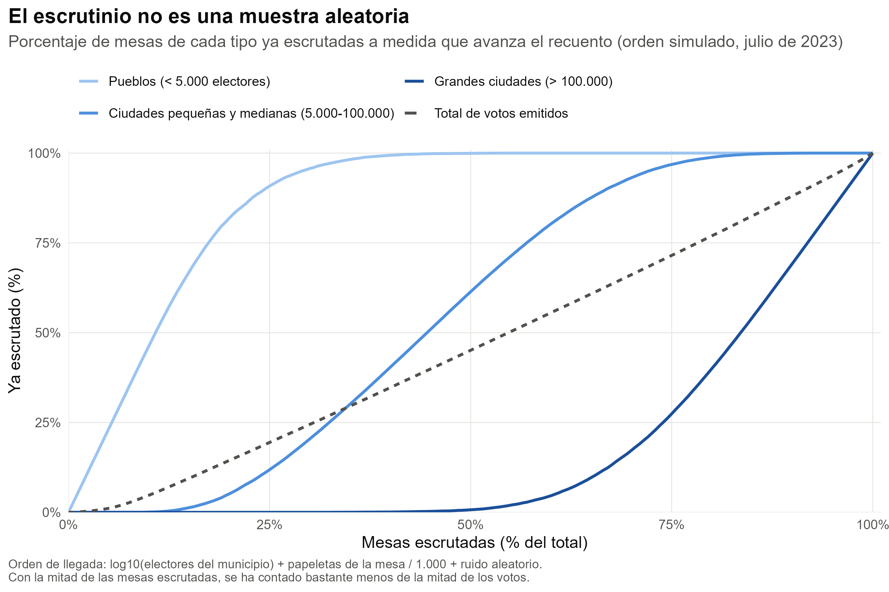
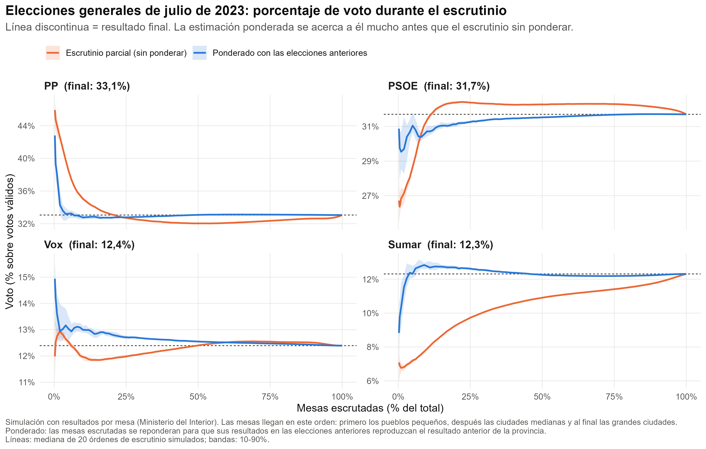
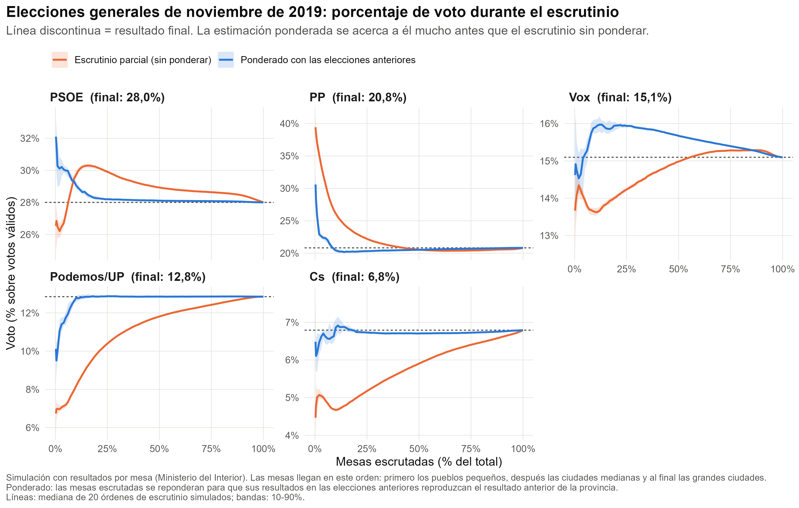
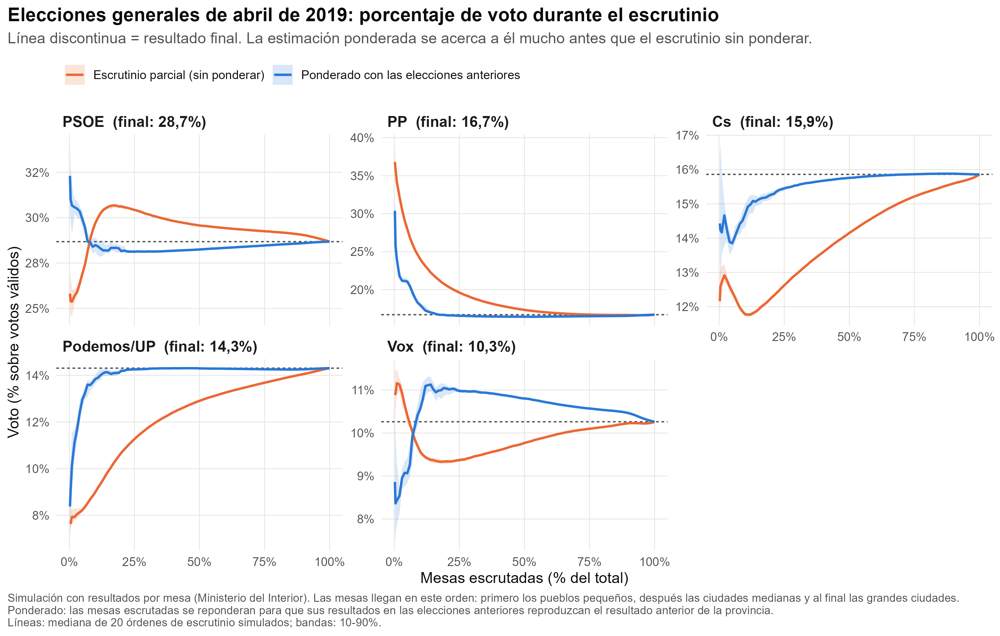
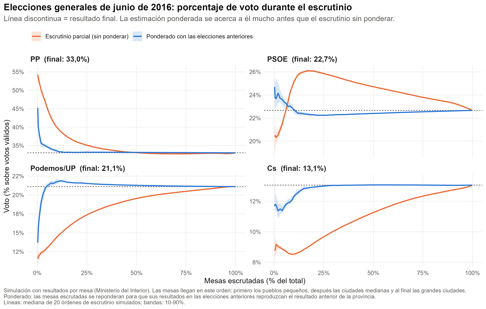
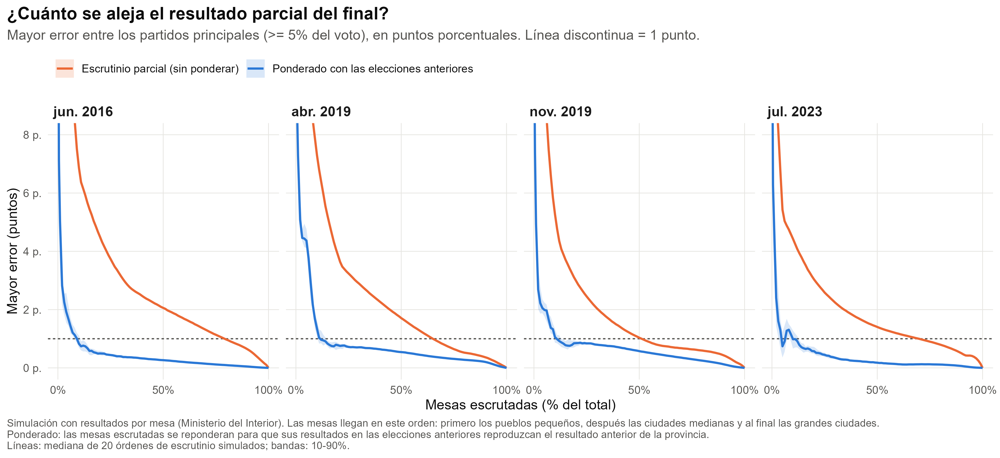
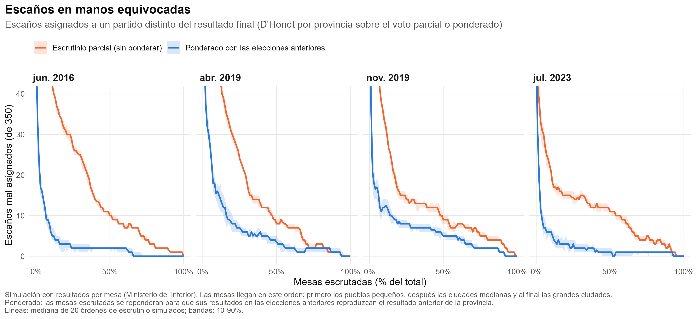
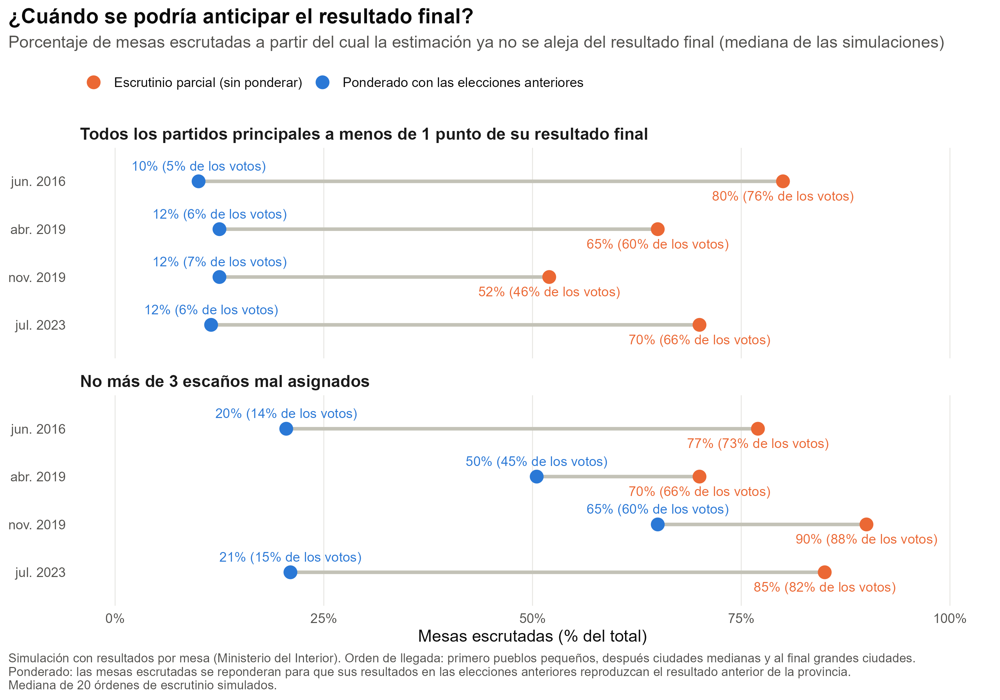

```{r}
#| label: setup
library(data.table)
library(knitr)

# Las figuras en castellano se generan con: Rscript R/02_figures.R es
if (!file.exists("output/figures_es/fig5_time_to_call.png")) {
  system2(file.path(R.home("bin"), "Rscript"), c("R/02_figures.R", "es"))
}

S   <- readRDS("output/sim_results.rds")
res <- S$results; fin <- S$finals; cfg <- S$cfg
tt  <- fread("output/time_to_reliable.csv")

# formato numérico en castellano
n1 <- function(x, d = 1) formatC(x, format = "f", digits = d, decimal.mark = ",", big.mark = ".")
p0 <- function(x) paste0(n1(x, 0), "%")
p1 <- function(x) paste0(n1(x, 1), "%")

el_es <- c("2016-06" = "junio de 2016", "2019-04" = "abril de 2019",
           "2019-11" = "noviembre de 2019", "2023-07" = "julio de 2023")

# composición de las mesas de 2023 según el tamaño del municipio
b23 <- S$booths[election == "2023-07"]
b23[, tramo := cut(muni_census, c(0, 5000, 1e5, Inf), labels = c("pueblos", "medianas", "grandes"))]
comp <- b23[, .(mesas = 100 * .N / nrow(b23), votos = 100 * sum(voters) / sum(b23$voters)), by = tramo]
setkey(comp, tramo)

# 2023: PP y PSOE en distintos momentos del escrutinio (mediana de simulaciones)
m23 <- res[election == "2023-07" & party %in% c("PP", "PSOE"),
           .(sh = median(share), v = median(pct_votes)), by = .(method, party, pct_booths)]
g <- function(m, p, s) m23[method == m & party == p & pct_booths == s, sh]
gv <- function(s) m23[pct_booths == s, v][1]
f23 <- fin[election == "2023-07"]
fs <- function(p) f23[party == p, share]

# tiempo hasta un resultado fiable
rng <- function(m, k) range(tt[method == m & metric == k, pct_booths])
```

*[Versió en català](informe_escrutini.html)*

## Resumen {.unnumbered}

La noche electoral, el Ministerio del Interior publica los resultados a medida que se escrutan las mesas. Este escrutinio parcial **no es una muestra representativa**: primero llegan las mesas de los pueblos pequeños, donde se vota de forma muy distinta a las grandes ciudades, y las mesas urbanas llegan al final. Por eso, el resultado provisional puede ser engañoso durante buena parte de la noche. De hecho, es habitual que algunos partidos empiecen el escrutinio y estén buena parte de la noche por delante y que después los resultados se den la vuelta.

Por este motivo, a menudo se recurre a las encuestas a pie de urna (caras y a menudo poco fiables) o a las encuestas realizadas los días previos a las elecciones, que son caras y poco precisas. Algunos partidos desarrollaron su propia solución. Unió Democràtica de Catalunya (UDC), en la época de Josep Antoni Duran i Lleida, el PSUC o el Partido Comunista Italiano (PCI) eran conocidos por disponer de un conjunto de "mesas testigo": mesas seleccionadas por un comportamiento electoral parecido al del conjunto, que usaban para anticipar el resultado final antes de que terminara el escrutinio. Este método, sin embargo, es costoso, porque exige una red de personas en esas mesas concretas, y depende de que esas mesas se escruten rápidamente. Lo que se presenta aquí es una alternativa mucho más sencilla y fiable, que aprovecha todas las mesas ya escrutadas.

Este informe muestra que una corrección muy sencilla lo resuelve en gran parte. Basta con **ponderar las mesas ya escrutadas para que, en conjunto, reproduzcan el resultado de las elecciones anteriores en cada provincia**. Con los datos reales mesa a mesa de cuatro elecciones generales (2016, abril de 2019, noviembre de 2019 y 2023) y un orden de escrutinio simulado, la estimación ponderada sitúa a todos los partidos principales a menos de un punto de su resultado final con solo un `r p0(rng("Weighted", "share")[1])`-`r p0(rng("Weighted", "share")[2])` de las mesas escrutadas. El escrutinio sin ponderar necesita entre el `r p0(rng("Raw count", "share")[1])` y el `r p0(rng("Raw count", "share")[2])`.

Es un método parecido al que utilizó la web [apuracaoaberta.com.br](https://apuracaoaberta.com.br/), que en las elecciones brasileñas predijo el resultado final con menos del 20% de las secciones escrutadas.

## El problema: el escrutinio no es aleatorio

Cuando cierran los colegios, cada mesa cuenta sus papeletas y transmite el resultado. El orden en que llegan los datos no es aleatorio, sino que sigue un patrón bastante previsible:

1. **Pueblos pequeños y zonas rurales.** Son las primeras mesas en llegar. Tienen pocos electores censados, el recuento físico dura pocos minutos y los resultados se transmiten enseguida.
2. **Ciudades pequeñas y medianas.** Llegan a media noche, de forma progresiva.
3. **Grandes ciudades y barrios densos.** Son las últimas. Hay cientos de votantes por urna y más presencia de interventores, que pueden ralentizar el proceso con reclamaciones legítimas.

Como el comportamiento electoral es muy distinto entre el mundo rural y el urbano, el escrutinio parcial tiene un sesgo sistemático. Durante la primera parte de la noche sobrerrepresenta a los partidos fuertes en los pueblos e infrarrepresenta a los partidos fuertes en las ciudades. Además, el porcentaje de mesas escrutadas (la cifra que se muestra en pantalla) exagera el avance real del recuento. En 2023, los municipios de menos de 5.000 electores tenían el `r p0(comp["pueblos", mesas])` de las mesas pero solo el `r p0(comp["pueblos", votos])` de los votos.

Esto es problemático porque implica que durante algunas horas en las pantallas de televisión se está ofreciendo (y comentando) información sesgada que se aleja de lo que será el resultado final. Esto puede generar confusión en la audiencia y, en un contexto como el actual, puede favorecer teorías de la conspiración sobre manipulación del recuento. Además, favorece que las televisiones públicas gasten dinero en encuestas a pie de urna o *trackings* de los últimos días de campaña que son caros y poco fiables. Finalmente, si el gobierno dispone de la información corregida antes que el resto de actores políticos, eso puede darle una ventaja indebida en una noche electoral.

La @fig-orden muestra el orden de llegada simulado para las elecciones de 2023. Cuando ya se han escrutado prácticamente todas las mesas de los pueblos, apenas se ha contado ninguna mesa de las grandes ciudades. Con el `r p0(50)` de las mesas escrutadas, se ha contado aproximadamente el `r p0(gv(50))` de los votos.

{#fig-orden}

## La solución: ponderar con las elecciones anteriores

### La idea

Aunque no sabemos cómo votarán las mesas que faltan, sí sabemos **cómo votaron en las elecciones anteriores**. Esta información permite medir el sesgo de las mesas ya escrutadas y corregirlo.

Supongamos que, en un momento de la noche, las mesas escrutadas de una provincia habían dado en las elecciones anteriores un 45% al partido A, mientras que el conjunto de la provincia le había dado un 35%. Entonces sabemos que la muestra parcial está sesgada a favor de ese partido. La corrección consiste en dar más peso a las mesas que se parecen a las que todavía faltan (por ejemplo, las mesas donde A era más débil) y menos a las que están sobrerrepresentadas, hasta que el conjunto ponderado reproduzca exactamente el resultado anterior de la provincia. Los votos *actuales* de esas mesas, con esos pesos, dan la estimación.

El supuesto es que, una vez igualado el perfil político previo, las mesas escrutadas y las que faltan cambian de forma parecida entre una elección y la siguiente. No hace falta que el cambio sea igual en todas partes, solo que no esté relacionado sistemáticamente con el orden de llegada una vez tenido en cuenta el voto anterior.

### Cómo se hace, paso a paso

Para cada momento del escrutinio y cada provincia:

1. **Perfil previo de cada mesa.** Cada mesa actual se asocia a su sección censal de las elecciones anteriores. De esa sección se toma el reparto del censo entre partidos, voto en blanco y nulo, y abstención. Más del `r p0(floor(100 * min(S$match_info$section)))` de las mesas se asocian directamente por sección. El resto (secciones nuevas o redibujadas) toma el perfil de su municipio.
2. **Objetivo.** Se suma este perfil para todas las mesas de la provincia, escrutadas o no. Este es el resultado anterior que las mesas escrutadas deben reproducir.
3. **Calibración.** Se buscan pesos para las mesas escrutadas de forma que la suma ponderada de su perfil previo coincida con el objetivo. Se utiliza el método de *raking* (calibración exponencial), que da siempre pesos positivos. Las categorías son los partidos con al menos un 3% del censo en la provincia en las elecciones anteriores, el resto de partidos agrupados y la abstención.
4. **Estimación.** Los votos actuales de cada partido en las mesas escrutadas se multiplican por los pesos y se suman. Si una provincia tiene menos de `r cfg$min_booths` mesas escrutadas (o menos del `r p0(100 * cfg$min_frac)` de sus mesas, en las provincias pequeñas), se utilizan las mesas escrutadas de toda la comunidad autónoma (o, si hace falta, de todo el Estado), pero calibradas igualmente al perfil previo de la provincia.
5. **Escaños.** Con los votos estimados de cada provincia se aplican la fórmula D'Hondt y el umbral del 3%, igual que en el reparto oficial.

El método no necesita hacer corresponder los partidos de unas elecciones y las siguientes. Los pesos se calculan con los partidos de la elección anterior y se aplican a los votos de cualquier partido de la actual, aunque sea nuevo (como Vox en 2019 o Sumar en 2023).

## Datos y simulación

Los datos son los ficheros oficiales de resultados por mesa del Ministerio del Interior para las elecciones al Congreso de diciembre de 2015, junio de 2016, abril de 2019, noviembre de 2019 y julio de 2023 (unas 57.000-60.000 mesas por elección). Las elecciones de 2015 solo se usan como referencia para ponderar las de 2016, porque no se dispone de las de 2011. Se evalúan, por tanto, cuatro elecciones. El voto exterior (CERA) no se incluye, porque no se transmite por mesas. El resultado final de referencia es el recuento completo de todas las mesas.

Los ficheros no indican a qué hora llegó cada mesa, de modo que el orden de llegada se ha **simulado** siguiendo la lógica descrita más arriba. Cada mesa recibe una puntuación igual al logaritmo del número de electores del municipio, más un término proporcional al número de papeletas de la mesa (las mesas grandes tardan más) y un ruido aleatorio. Las mesas se escrutan por orden creciente de puntuación. Para tener en cuenta la incertidumbre del orden, la simulación se repite con `r cfg$n_reps` órdenes aleatorios distintos por elección. Las figuras muestran la mediana y el intervalo del 10% al 90% de esas simulaciones.

## Resultados

### La evolución de la noche electoral

Las figuras siguientes muestran, para cada elección, cómo evolucionaría el porcentaje de voto de los partidos principales (los que superan el 5%) según el número de mesas escrutadas. La línea naranja es lo que se vería en pantalla. La línea azul es la estimación ponderada. La línea discontinua es el resultado final.

::: {.panel-tabset}

## Julio de 2023



## Noviembre de 2019



## Abril de 2019



## Junio de 2016



:::

El patrón se repite en todas las elecciones. Con las primeras mesas rurales, el escrutinio sin ponderar sobrestima mucho al PP e infraestima a los partidos con más voto urbano (Podemos/Unidas Podemos, Ciudadanos, Sumar). El sesgo se va reduciendo poco a poco y solo desaparece cuando llegan las grandes ciudades. La estimación ponderada también es inestable durante los primeros minutos, cuando se han escrutado muy pocas mesas, pero se estabiliza muy pronto cerca del resultado final.

El caso de julio de 2023 es especialmente ilustrativo. Con la mitad de las mesas escrutadas, el escrutinio sin ponderar situaba al PSOE (`r p1(g("Raw count", "PSOE", 50))`) por delante del PP (`r p1(g("Raw count", "PP", 50))`). Con el 75% de las mesas escrutadas, los dos partidos todavía aparecían prácticamente empatados. El resultado final fue un `r p1(fs("PP"))` para el PP y un `r p1(fs("PSOE"))` para el PSOE. Con solo el 10% de las mesas escrutadas (un `r p0(gv(10))` de los votos), la estimación ponderada ya daba un `r p1(g("Weighted", "PP", 10))` al PP y un `r p1(g("Weighted", "PSOE", 10))` al PSOE. Con el 50% de las mesas escrutadas, la cifra era de `r p1(g("Weighted", "PP", 50))` y `r p1(g("Weighted", "PSOE", 50))`.

### Error en el porcentaje de voto

La @fig-error resume esta información con una sola medida: la diferencia más grande, en puntos porcentuales, entre el porcentaje provisional y el final de cualquiera de los partidos principales.

{#fig-error}

En las cuatro elecciones, el error de la estimación ponderada baja de un punto cuando se ha escrutado alrededor del 10-12% de las mesas y ya no vuelve a subir. En el escrutinio sin ponderar, el error es de varios puntos durante buena parte de la noche.

### Error en el reparto de escaños

El reparto de escaños es más exigente, porque se decide provincia a provincia y muchos escaños dependen de diferencias de pocos votos. La @fig-escanos muestra cuántos escaños quedarían asignados a un partido distinto del que finalmente los obtiene.

{#fig-escanos}

La estimación ponderada reduce mucho el error también en escaños, pero la mejora depende de la elección. En 2016 y en 2023, con alrededor del 20% de las mesas escrutadas la estimación ponderada ya no se equivoca en más de 2 o 3 escaños. En las dos elecciones de 2019 hacen falta muchas más mesas, por tres motivos:

- **Fragmentación y márgenes muy estrechos.** En 2019 había cinco partidos (PSOE, PP, Cs, Podemos y Vox) que competían por el último escaño en muchas provincias. El número efectivo de partidos era de 5,8, frente a 4,4 en 2016 y 4,1 en 2023. Los escaños que la estimación ponderada asigna mal son casi siempre escaños que se decidieron por márgenes mínimos: Zaragoza (abril) por 0,01 puntos, Bizkaia (noviembre) por 0,02, Málaga (noviembre) por 0,04, Madrid por entre 0,05 y 0,15 y Navarra por 0,12. Un error de 0,1 o 0,2 puntos, irrelevante para el porcentaje de voto, basta para cambiar estos escaños.
- **Un partido nuevo o en fuerte crecimiento.** La mayoría de estos errores implican a Vox. En abril de 2019, Vox casi no tenía resultado previo (en 2016 era testimonial) y, por tanto, la ponderación no podía tener en cuenta dónde era fuerte. En noviembre, su crecimiento respecto a abril fue desigual entre territorios. Las primeras mesas predicen peor la fuerza local de Vox, y eso pesa justamente donde Vox se juega el último escaño.
- **Ceuta y Melilla.** Cada una elige un solo diputado y sus mesas llegan tarde, hacia la mitad del escrutinio. Hasta entonces no hay ninguna mesa propia para estimar su resultado y hay que utilizar mesas de otros territorios, que no pueden anticipar cambios locales como la victoria del PSOE en Ceuta en abril de 2019 o la de Vox en noviembre. Para reducir este problema, la estimación de una provincia pequeña utiliza sus propias mesas cuando se ha escrutado un 25% de ellas (en lugar de esperar a 30), pero el efecto es pequeño.

Además, el criterio es exigente: pide que el error no supere los tres escaños *desde ese momento hasta el final*, de modo que un solo escaño que cambia de manos tarde retrasa todo el cálculo. En conclusión, el método anticipa bien el porcentaje de voto, pero los escaños decididos por márgenes muy estrechos siguen siendo inciertos hasta que se ha contado buena parte de los votos, y ninguna estimación puede evitarlo. Para la noche electoral sería más honesto dar una horquilla de escaños por partido que una cifra única.

### ¿Cuándo se podría anticipar el resultado?

La @fig-anticipar y la @tbl-anticipar recogen la conclusión principal. Para cada elección, muestran el porcentaje de mesas (y de votos) que hay que tener escrutado para que la estimación ya no se aleje del resultado final hasta el final de la noche. Se utilizan dos criterios: que todos los partidos principales estén a menos de un punto de su resultado final, y que no haya más de tres escaños mal asignados.

{#fig-anticipar}

```{r}
#| label: tbl-anticipar
#| tbl-cap: "Porcentaje de mesas escrutadas (y de votos contados) a partir del cual la estimación es fiable hasta el final. Mediana de las simulaciones."
w <- dcast(tt, election ~ metric + method, value.var = c("pct_booths", "pct_votes"))
cell <- function(b, v) paste0(p0(b), " (", p0(v), ")")
tab <- data.table(
  `Elecciones` = el_es[w$election],
  `Voto: sin ponderar` = cell(w$`pct_booths_share_Raw count`, w$`pct_votes_share_Raw count`),
  `Voto: ponderado` = cell(w$pct_booths_share_Weighted, w$pct_votes_share_Weighted),
  `Escaños: sin ponderar` = cell(w$`pct_booths_seats_Raw count`, w$`pct_votes_seats_Raw count`),
  `Escaños: ponderado` = cell(w$pct_booths_seats_Weighted, w$pct_votes_seats_Weighted))
kable(tab, align = "lcccc")
```

Con el criterio del porcentaje de voto, la ponderación permite anticipar el resultado con entre 4 y 8 veces menos mesas escrutadas. En la práctica, esto significa que el resultado se podría conocer con bastante precisión poco después de que empiecen a llegar los datos, cuando todavía solo se ha contado alrededor del 5-7% de los votos, en lugar de tener que esperar a que lleguen las grandes ciudades.

## ¿Por qué no se hace?

Si la corrección es tan sencilla y los datos de las elecciones anteriores son públicos, la pregunta es obvia: ¿por qué no se hace la noche electoral? La respuesta está en el formato en que se difunden los datos.

### Los resultados parciales no dicen qué mesas se han escrutado

Durante la noche electoral, los resultados provisionales se publican agregados por territorios, junto con el porcentaje de mesas escrutadas. Lo que no se publica es **qué mesas concretas** forman parte de ese recuento parcial. Sin esta información, no se puede saber cómo votaron esas mesas en las elecciones anteriores y, por tanto, no se puede calcular la ponderación. Actualmente, el análisis de este informe solo es posible a posteriori, con los ficheros definitivos mesa a mesa y simulando el orden de llegada. La noche electoral, nadie fuera de la administración puede replicarlo.

### Un cambio menor en la difusión de los datos

Para hacerlo posible no haría falta que el Ministerio hiciera ninguna estimación ni publicara ninguna proyección. Bastaría con un cambio muy pequeño en la difusión: publicar, a medida que llegan, **los resultados de cada mesa con su código identificador** (provincia, municipio, distrito, sección y mesa), o, como mínimo, la lista de mesas incluidas en cada actualización. Estos códigos ya existen y son los mismos que se usan en los ficheros definitivos. Además, cada mesa transmite su resultado de forma individual, de modo que la información ya está en el sistema y solo habría que difundirla con este nivel de detalle.

Con estos datos, cualquier medio de comunicación, partido o equipo de investigación podría aplicar esta corrección, u otras mejores, en tiempo real y con total transparencia.

### Qué se ganaría

- **La ciudadanía sabría antes qué está pasando.** Como muestran los resultados anteriores, el resultado final en porcentaje de voto se podría conocer con un margen de error pequeño cuando todavía solo se ha contado alrededor del 5-7% de los votos.
- **Las televisiones podrían ahorrar dinero.** Las encuestas de la noche electoral solo sirven para cubrir un rato de pantalla, pero a menudo han sido imprecisas y cuestan mucho dinero. Con este método se podría pasar directamente al recuento y saltarse el paso intermedio.
- **Se evitarían resultados parciales engañosos en las pantallas.** Durante horas, el recuento provisional puede transmitir una imagen equivocada de quién gana. En la simulación de 2023, por ejemplo, el escrutinio sin ponderar sitúa al PSOE por delante del PP durante buena parte de la noche, cuando el resultado final es el contrario. Estas impresiones condicionan las primeras declaraciones de los partidos, la cobertura mediática y la percepción pública, y después hay que deshacerlas.
- **Se reducirían las asimetrías de información.** Es razonable pensar que el Gobierno, y en general quienes gestionan el recuento, disponen de los resultados mesa a mesa en tiempo real y, por tanto, pueden hacer este tipo de estimación durante la noche electoral. Mientras tanto, el resto de actores (partidos de la oposición, medios y ciudadanía) solo ven el agregado sesgado. Publicar los datos por mesa pondría a todo el mundo en igualdad de condiciones.

## Limitaciones

- **El orden de escrutinio es simulado.** Reproduce el patrón general (pueblos, ciudades medianas, grandes ciudades), pero no el orden real de cada noche electoral. Si el orden real tuviera sesgos adicionales no relacionados con el tamaño del municipio ni con el voto anterior, el método los corregiría menos.
- **El método supone que el cambio electoral es parecido entre mesas con el mismo perfil previo.** Funciona muy bien cuando los cambios son generales. Si un partido crece solo en un tipo de territorio que llega tarde (por ejemplo, solo en los barrios de una gran ciudad), la estimación inicial lo captaría con retraso.
- **Las primeras mesas dan estimaciones inestables.** Con menos del 1-2% de las mesas escrutadas, la estimación ponderada también puede equivocarse en varios puntos. Sería recomendable acompañarla de un margen de error o no publicarla hasta tener un mínimo de mesas por provincia.
- **No se incluye el voto exterior (CERA)**, que se escruta días después y puede cambiar algún escaño ajustado.
- **Los datos de 2015 tienen algunas inconsistencias.** En unas 26.000 mesas, el total de votos a candidaturas no coincide con la suma de los votos de cada candidatura. Se ha tomado como buena la suma por candidatura. Estos datos solo se usan para ponderar las elecciones de 2016.

## Conclusión

El porcentaje de voto que se muestra durante la noche electoral es engañoso porque las mesas no llegan al azar. No hace falta ningún modelo sofisticado para corregirlo: basta con utilizar una información pública, el resultado de las elecciones anteriores en cada sección censal, para reponderar las mesas ya escrutadas. Con esta corrección, el resultado final en porcentaje de voto se podría anticipar con un 10-12% de las mesas escrutadas, en lugar del 50-80% que requiere el escrutinio sin ponderar. Si hoy no se puede hacer es porque los resultados parciales no identifican qué mesas se han escrutado. Publicarlos mesa a mesa a medida que llegan sería un cambio menor y técnicamente factible. Pero sería muy importante desde un punto de vista democrático. Permitiría a la ciudadanía conocer antes el resultado, evitaría los resultados parciales engañosos que pueden generar confusión y alimentar teorías de la conspiración, y reduciría la ventaja informativa de quien tiene acceso a los datos completos durante la noche electoral.

## Reproducir el análisis {.unnumbered}

Todo el código está en R y se encuentra en la carpeta `R/`:

- `R/00_functions.R`: lectura de los ficheros del Ministerio, calibración (*raking*) y D'Hondt.
- `R/01_simulate.R`: simulación del escrutinio (genera `output/sim_results.rds`; unos 5 minutos).
- `R/02_figures.R`: figuras en inglés (`Rscript R/02_figures.R`), en catalán (`Rscript R/02_figures.R ca`) o en castellano (`Rscript R/02_figures.R es`).
- `informe_escrutini_es.qmd`: este informe (`quarto render informe_escrutini_es.qmd`). La versión en catalán es `informe_escrutini.qmd`.
